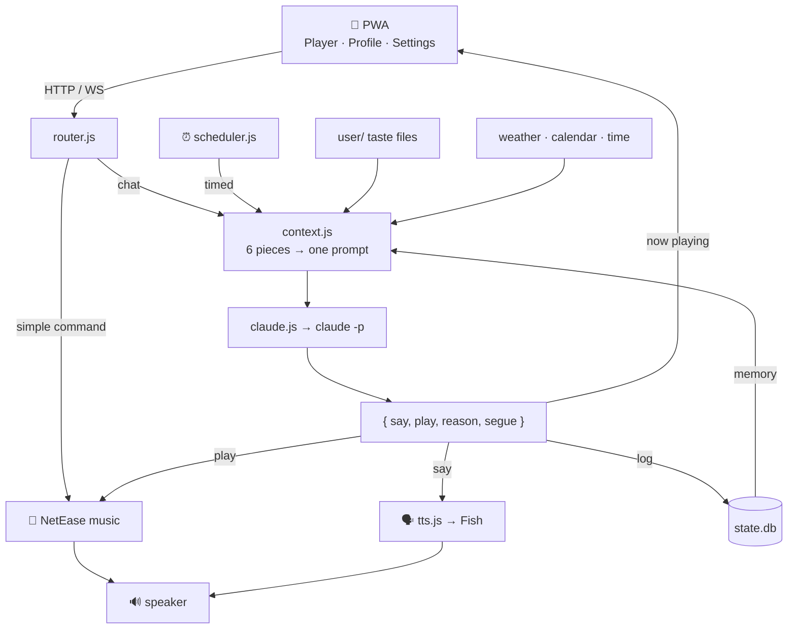

# Claudio

**A personal AI radio DJ.** It learns your taste, plans your day's music, and talks between songs like a real host.

> Inspired by **@mmguo**'s blueprint on Douyin — "把我十四年的歌单，蒸馏成了AI电台" ("I distilled 14 years of playlists into an AI radio").
> This repo is my build of it: research, design, and code.

## Status

| Part | State |
|---|---|
| Output contract | ✅ done |
| Brain adapter — `claude.js` | ✅ done, tested |
| Memory — `state.db` schema | ✅ done, tested |
| DJ persona | ✅ draft |
| Music — NetEase | ⏭ next |
| Context, voice, router, server | planned |
| PWA — Player / Profile / Settings | planned |
| Scheduler | planned |

Full list: [roadmap](docs/roadmap.md).

## How it works



- **Every trigger builds one prompt from 6 pieces:** persona, taste, environment, memory, input, trigger.
- **Claude returns one JSON:** `{say, play[], reason, segue}`.
- **That JSON drives everything:** NetEase queues the songs, Fish speaks the line, the app updates live.
- **The brain is Claude Code itself,** run as `claude -p` on a Claude subscription. No API key.

More: [architecture](docs/02-architecture.md).

## The process

| Step | Doc |
|---|---|
| 1. Research | [01-research.md](docs/01-research.md) — source, demand, dependency check |
| 2. Architecture | [02-architecture.md](docs/02-architecture.md) — 4 layers, contracts, fixes |
| 3. Design | [03-design.md](docs/03-design.md) — views, UI ↔ data map, open questions |
| 4. Decisions | [04-decisions.md](docs/04-decisions.md) — what I chose and why |
| 5. Build | [roadmap.md](docs/roadmap.md) — step by step |

## Run it

Needs Node 22.5+ and [Claude Code](https://code.claude.com/docs/en/overview) logged in with a Claude subscription.

```bash
git clone https://github.com/sharontao0420/claudio.git
cd claudio
cp -r user.example user   # then make it yours
cp .env.example .env
npm test
npm run db:init           # creates state.db
```

## Repo map

```
docs/           research → architecture → design → decisions → roadmap
prompts/        dj-persona.md — who Claudio is (context piece ①)
src/
  claude.js                  calls Claude, returns the output shape
  brain-output.schema.json   the output contract
  db/schema.sql              state.db: messages, plays, plan, prefs
scripts/        init-db.js
test/           node:test, no dependencies
user.example/   taste file templates (your real ones go in user/, not committed)
AGENTS.md       rules for coding agents
```

## Built with

- [Claude Code](https://code.claude.com) — as the DJ's brain, and as my pair programmer.

## License

MIT
