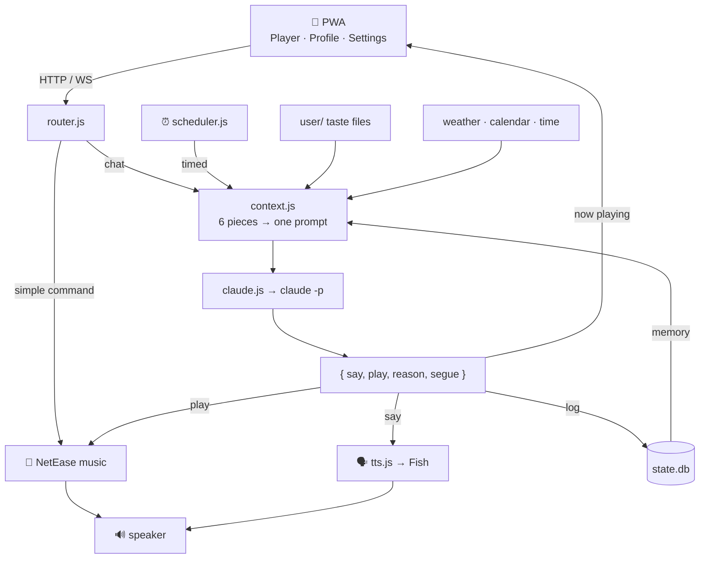

# 02 · Architecture

Based on @mmguo's blueprint. Redrawn in English, with fixes noted.

## The big picture

## Layer 1 · Inputs and outputs

| Part | What it does | File / tool |
|---|---|---|
| Taste files | Make the DJ yours | `user/taste.md`, `routines.md`, `playlists.json`, `mood-rules.md` |
| Brain | Picks songs, writes lines | `claude -p` on a Claude subscription |
| Music | Search, play links, lyrics, picks | NeteaseCloudMusicApi |
| Voice | Text → speech | Fish Audio |
| Environment | Weather, calendar, time | any weather API, any calendar |
| Speaker | Plays out loud | UPnP speaker, or the browser |

## Layer 2 · Local brain

| Module | Job | Status |
|---|---|---|
| `router.js` | "Pause" goes direct. Music goes to NetEase. Chat goes to Claude. | planned |
| `context.js` | Builds the 6-piece prompt | planned |
| `claude.js` | Calls Claude, returns the output shape, never crashes | ✅ |
| `scheduler.js` | 07:00 plan · 09:00 show · hourly mood check · calendar hook | planned |
| `tts.js` | Fish → `cache/tts/<hash>.mp3`. Same line is never paid twice. | planned |
| `state.db` | messages · plays · plan · prefs. Survives restarts. | ✅ schema |

## Layer 3 · Context window

Every trigger glues these 6 pieces, in this order:

| # | Piece | Source |
|---|---|---|
| ① | Persona | `prompts/dj-persona.md` |
| ② | Taste | `user/*.md` |
| ③ | Environment | weather · calendar · now |
| ④ | Memory | `state.db` → plays |
| ⑤ | Input / tool results | `/api/chat` · NetEase search |
| ⑥ | Trigger | scheduler · webhook |

Then:

1. Claude returns `{say, play[], reason, segue}`.
2. NetEase turns `play[]` into a queue.
3. Fish turns `say` into audio.
4. WebSocket pushes "now playing" to the app.

## The output contract

The one thing every part agrees on. File: [`src/brain-output.schema.json`](../src/brain-output.schema.json).

| Field | Type | Who uses it |
|---|---|---|
| `say` | string | `tts.js` → speaker. Empty = silence. |
| `play` | `{title, artist, id?, why?}[]` | `router.js` → NetEase → queue. Max 10. |
| `reason` | string | `state.db` only. Never spoken. |
| `segue` | string | `tts.js`, between songs. |

## Layer 4 · Interface

- PWA at `localhost:8080`.
- 3 views: Player, Profile, Settings.
- Caches its shell. Prefetches 10 seconds ahead.

**HTTP contract — 6 lines**

| Method | Path | Status |
|---|---|---|
| GET | `/api/now` | from blueprint |
| GET | `/api/taste` | from blueprint |
| GET | `/api/plan/today` | from blueprint |
| WS | `/stream` | from blueprint |
| POST | `/api/chat` | likely — named in piece ⑤, hidden in blueprint |
| ? | ? | hidden in blueprint — to be designed |

## Fixes to the original blueprint

- `claude -p --output json` → `claude -p --output-format json --json-schema <schema>`.
- Added: the brain cannot run tools (`--permission-mode dontAsk`).
- Added: `user/` stays private. `user.example/` holds templates.
